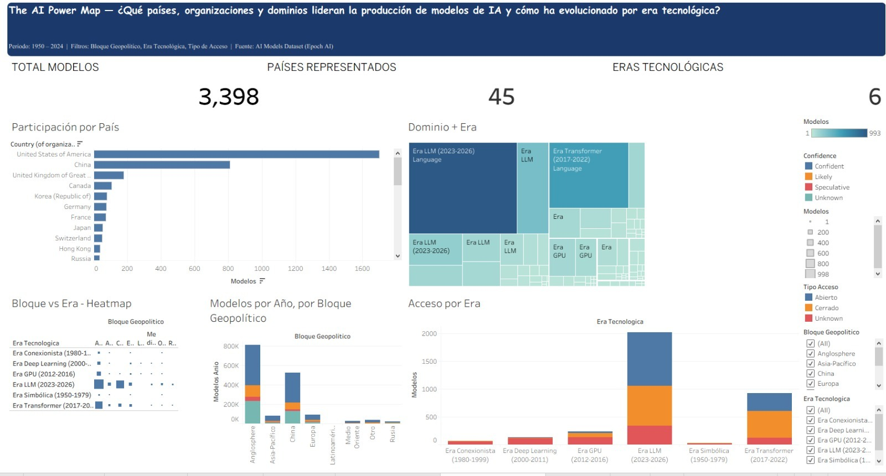

# The AI Power Map

Análisis de la concentración geográfica, organizacional y tecnológica de **3,405 modelos de inteligencia artificial** (1950–2026) del dataset público de [Epoch AI](https://epoch.ai/data), con un pipeline reproducible en Python y fuentes de datos para un dashboard en Tableau.

> **Pregunta central:** ¿quién concentra hoy el poder tecnológico de la IA y qué factores explican esa concentración?

## Hallazgos principales

- **Dos bloques concentran más del 80% de la producción:** Anglosphere (58%, 1,991 modelos) y China (25%, 847 modelos). Latinoamérica aparece con 2 modelos.
- **La industria desplazó a la academia:** pasó de 270 modelos en la década de 2010 a 1,801 en la de 2020 (Academia: 349 → 677) y concentra el 62% del total.
- **Un solo dominio domina:** Language representa el 48% de todos los modelos.
- **Estructura técnica (PCA y t-SNE sobre 632 modelos):** los modelos se agrupan por era tecnológica y tipo de productor, no por bloque geopolítico. El bloque no fue variable de entrada, así que es una lectura indirecta.

Detalle y limitaciones en el [resumen ejecutivo](docs/resumen_ejecutivo.md).

## Dashboard

Las fuentes de datos del dashboard de Tableau están en [`outputs/tableau/`](outputs/tableau/): un esquema estrella (`fact_models` + 4 dimensiones), la tabla analítica `fact_models_gold.csv`, las tablas de segmentación `seg_*.csv` y las coordenadas PCA/t-SNE.

## Dashboard



Las fuentes de datos del dashboard están en [`outputs/tableau/`](outputs/tableau/): un esquema estrella (`fact_models` + 4 dimensiones), la tabla analítica `fact_models_gold.csv`, las tablas de segmentación `seg_*.csv` y las coordenadas PCA/t-SNE.

## Visualizaciones del análisis

PCA (estructura global) frente a t-SNE (estructura local), coloreados por era tecnológica:


## Qué se analizó

Los notebooks se ejecutan en orden. Cada uno indica sus entradas y salidas en el encabezado.

| # | Notebook | Qué hace | Técnicas y decisiones |
|---|---|---|---|
| 01 | [`perfilado_y_limpieza`](notebooks/01_perfilado_y_limpieza.ipynb) | Perfila el dataset crudo (3,509 filas × 57 columnas) y lo limpia hasta 3,405 × 22 | Análisis de nulos y cardinalidad, deduplicación por `Model`, homologación de categorías, imputación con `Unknown` en categóricas |
| 02 | [`analisis_exploratorio`](notebooks/02_analisis_exploratorio.ipynb) | Explora la distribución por año, país, dominio, organización y accesibilidad | Distribuciones, evolución por década, correlación entre variables numéricas |
| 03 | [`modelo_de_datos_plano_vs_estrella`](notebooks/03_modelo_de_datos_plano_vs_estrella.ipynb) | Compara dos estructuras de datos para Tableau y elige una | Métricas de validación estructural; esquema estrella frente a tabla plana |
| 04 | [`segmentacion_y_metricas`](notebooks/04_segmentacion_y_metricas.ipynb) | Segmenta y calcula métricas derivadas (capa Gold) | Bloque geopolítico, era tecnológica, tipo de acceso, log(x+1), participación porcentual, acumulados |
| 05 | [`reduccion_dimensionalidad_pca_tsne`](notebooks/05_reduccion_dimensionalidad_pca_tsne.ipynb) | Busca estructura técnica en 632 modelos | StandardScaler, PCA (varianza y loadings), t-SNE, validación con otra semilla |
| — | [`exploraciones/`](notebooks/exploraciones/exploracion_preprocesamiento_pca_kmeans.ipynb) | Preprocesamiento para PCA + K-Means (1,212 filas) | Selección de variables por cobertura y one-hot encoding. K-Means no llegó a ejecutarse; no forma parte del análisis final |

### Decisiones y opciones evaluadas

| Decisión | Opciones | Elegida | Por qué |
|---|---|---|---|
| Modelo de datos para Tableau | Tabla plana, esquema estrella (el copo de nieve se descartó por innecesario) | Esquema estrella | Conserva las 3,405 filas, no genera llaves nulas y evita repetir atributos. La tabla plana queda como respaldo |
| Nulos numéricos | Imputar o conservar | Conservar | Imputar sesgaría variables con distribución muy asimétrica |
| Nulos categóricos | Descartar filas o etiquetar | Etiquetar como `Unknown` | No se pierden filas en el análisis |
| Escalado antes de PCA | StandardScaler o MinMaxScaler | StandardScaler | MinMaxScaler es más sensible a outliers extremos |
| Variables numéricas | Originales o log(x+1) | log(x+1) | Reduce la asimetría y evita log(0) |
| Reducción de dimensionalidad | PCA, t-SNE o ambos | Ambos | PCA muestra estructura global; t-SNE, vecindarios locales |
| Agrupar con K-Means | Evaluar con silhouette (k de 2 a 8) | No usado | Silhouette entre 0.21 y 0.33 y grupos muy desparejos (hasta 86.6% en uno): no hay grupos claramente separados |

### Conceptos usados

| Concepto | En palabras simples |
|---|---|
| **PCA** | Resume muchas variables en pocas dimensiones conservando la mayor varianza posible. Sirve para ver qué variables explican más |
| **t-SNE** | Acerca los elementos parecidos entre sí. Preserva vecindarios locales, no distancias globales, y no debe leerse como distancia real entre grupos |
| **StandardScaler** | Centra cada variable en media 0 y desviación 1, para que ninguna domine por tener valores grandes |
| **One-hot encoding** | Convierte cada categoría en una columna 0/1 |
| **Esquema estrella** | Una tabla de hechos conectada a tablas de dimensiones |
| **Arquitectura Medallion** | Bronze (dato crudo) → Silver (dato limpio) → Gold (dato listo para análisis) |

## Arquitectura de datos

| Capa | Ubicación | Contenido |
|---|---|---|
| Bronze | `data/raw/all_ai_models.csv` | Dataset original (3,509 × 57) |
| Silver | `data/processed/all_ai_models_clean.csv` | Dataset limpio (3,405 × 22) |
| Gold | `outputs/tableau/` | Esquema estrella, `fact_models_gold.csv` (3,405 × 45), tablas `seg_*` y embedding PCA/t-SNE (632 filas) |

## Cómo reproducir

Requiere Python 3.10 o superior.

```bash
git clone <url-del-repositorio>
cd Data_Visualization_TF

python -m venv .venv
.venv\Scripts\activate        # Windows (PowerShell). En Linux/macOS: source .venv/bin/activate
pip install -r requirements.txt

python -m src.pipeline         # regenera Silver y Gold (limpieza, esquema estrella, segmentación)
jupyter lab                    # abrir notebooks/ y ejecutarlos en orden
```

`python -m src.pipeline` regenera todas las tablas de `data/processed/` y `outputs/` excepto el análisis PCA/t-SNE, que se genera ejecutando el notebook 05.

## Estructura del repositorio

```text
Data_Visualization_TF/
├── LICENSE
├── requirements.txt
├── data/
│   ├── README.md             # fuente, licencia y modificaciones de los datos
│   ├── raw/                  # Bronze: all_ai_models.csv (Epoch AI)
│   └── processed/            # Silver: all_ai_models_clean.csv
├── notebooks/
│   ├── 01_perfilado_y_limpieza.ipynb
│   ├── 02_analisis_exploratorio.ipynb
│   ├── 03_modelo_de_datos_plano_vs_estrella.ipynb
│   ├── 04_segmentacion_y_metricas.ipynb
│   ├── 05_reduccion_dimensionalidad_pca_tsne.ipynb
│   └── exploraciones/
├── src/
│   ├── config.py             # rutas y listas de columnas
│   ├── io_utils.py           # lectura y escritura de CSV
│   ├── preprocessing.py      # Bronze → Silver
│   ├── modeling.py           # tabla plana y esquema estrella
│   ├── analytics.py          # segmentación y métricas (Gold)
│   └── pipeline.py           # python -m src.pipeline
├── outputs/
│   ├── reports/              # métricas de calidad y figuras PCA/t-SNE
│   └── tableau/              # fuentes de datos del dashboard
└── docs/
    ├── resumen_ejecutivo.md
    ├── modelo_de_datos_y_preprocesamiento.md
    └── images/               # capturas del dashboard
```

## Limitaciones

- PCA y t-SNE cubren 632 de 3,405 modelos (18.6%): solo los que tienen completas las variables numéricas clave.
- `Parameters`, `Training compute (FLOP)` y `Citations` tienen 34%, 60% y 57% de nulos. No se imputaron.
- Los bloques geopolíticos mapean 28 países de forma explícita. Los 81 modelos (2.4%) de otros 20 países quedan en el bloque "Otro".

## Licencias, fuente de datos y autores

- **Código:** licencia [MIT](LICENSE).
- **Datos:** Epoch AI, *All AI Models*, bajo [CC BY 4.0](https://creativecommons.org/licenses/by/4.0/). Los datos derivados (`data/processed/` y `outputs/`) conservan la atribución a Epoch AI. Detalle, cita y lista de modificaciones en [`data/README.md`](data/README.md).
- **Autores:** Fabian Marcelo Rojas Cuadros y Lazaro Machado Luis Isaac. Equipo DataChasquiAILab, curso Data Visualization, Universidad Peruana de Ciencias Aplicadas.
